<div align="center">

[](https://github.com/katarinagresova/pitstop/actions/workflows/tests.yml)
[](pyproject.toml)
[](https://katarinagresova.github.io/pitstop/)

<p><picture></picture></p>

**Ribo-seq reads in, translation out.**

</div>

<picture>

</picture>

pitstop is a Python toolkit for ribosome profiling (Ribo-seq). Give it
footprints aligned to the transcriptome, and it gives you plain tables to take
straight into your analysis.

## What it does

| Question | Command | You get |
|---|---|---|
| Is my library good, and which read lengths do I use? | `pitstop inspect` | an HTML report and tables: for each read length, how well its reads keep one reading frame, flags for common library problems, and the read lengths to use |
| Can my reads be repaired? | `pitstop repair` | a new BAM in which extra 5' nucleotides that do not match the transcript are clipped, and a table of the reads it changed |
| How much is each coding sequence translated? | `pitstop quant` | reads per CDS, with reads shared by isoforms or paralogs split between them |
| Which uORFs and other small ORFs are translated? | `pitstop orfs`, `pitstop score` | for each ORF in your table, how strongly its reads follow its reading frame, with a p-value |
| Where does translation start? | `pitstop starts` | start sites at ATG and near-cognate codons from harringtonine libraries, and a uORF catalogue from them |

<picture>

</picture>

## Why pitstop

- **Learns from your data.** The P-site offset of each read length is
  estimated from the reads, not assumed.
- **Keeps the reading frame.** For uORFs, every read keeps its frame, and the
  score allows for the off-frame noise of the coding sequence they overlap.
- **Reproducible.** No random numbers anywhere: the same input gives the same
  output, byte for byte.
- **Checked on real data**, not only on simulations: see how the
  [uORF scores](https://katarinagresova.github.io/pitstop/orfs/#validation-on-real-data) and
  [start sites](https://katarinagresova.github.io/pitstop/starts/#validation-on-real-data) hold up.

## Install

```bash
pip install git+https://github.com/katarinagresova/pitstop.git
```

pitstop needs Python 3.10 or later.

## Quick start

pitstop reads footprints aligned to the transcript sequences (for example with
STAR or bowtie), and the GTF and genome FASTA the transcripts come from.

```bash
pitstop quant --bam sample.bam --gtf annotation.gtf --fasta genome.fa \
    --read-lengths 18-30 --out-prefix out/sample
```

This writes `out/sample.quant.tsv` (reads per CDS), `out/sample.offsets.tsv`
(the P-site offset of each read length) and a few more tables, among them one
for quality-control plots.

Not sure which `--read-lengths` to use? `pitstop inspect` checks a library and
names the read lengths that keep their reading frame. If it finds extra
nucleotides at the 5' end of the reads, let the aligner clip them the next time
(STAR with `--quantTranscriptomeSAMoutput BanSingleEnd`, or bowtie2 `--local`).
For the BAM you have, `pitstop repair` clips them and writes a new BAM for the
other commands.

To test candidate uORFs, count reads on your ORF table in each replicate, then
score the ORFs over all of them:

```bash
pitstop orfs --bam rep1.bam --gtf annotation.gtf --fasta genome.fa \
    --read-lengths 18-30 --orfs candidates.tsv --out-prefix out/rep1
# the same for rep2, with --offsets out/rep1.offsets.tsv: libraries scored together share one offsets table
pitstop score --orfs-prefix out/rep1 out/rep2 --out-prefix out/pooled
```

`out/pooled.scores.tsv` has a p- and q-value for each ORF. For start sites
from harringtonine libraries, see [Usage](https://katarinagresova.github.io/pitstop/usage/#start-sites-starts).

## Documentation

**[katarinagresova.github.io/pitstop](https://katarinagresova.github.io/pitstop/)**

- [Usage](https://katarinagresova.github.io/pitstop/usage/): every command, input format and output column
- [Read QC flags](https://katarinagresova.github.io/pitstop/flags/): what each flag of `pitstop inspect` means,
  its cut and why, and what to do
- [Typical workflows](https://katarinagresova.github.io/pitstop/#typical-workflows): which commands to run, in which
  order, for elongation libraries, initiation and elongation libraries, and comparisons of conditions
- [Method: quant](https://katarinagresova.github.io/pitstop/method/): offsets, assignment and the EM, with interactive examples
- [Method: ORF counting](https://katarinagresova.github.io/pitstop/orfs/): the frame score, with an interactive example and
  validation on real data
- [Method: start sites](https://katarinagresova.github.io/pitstop/starts/): the harringtonine test, with validation on real data

## License

Apache License 2.0, see [LICENSE](LICENSE) and [NOTICE](NOTICE).
